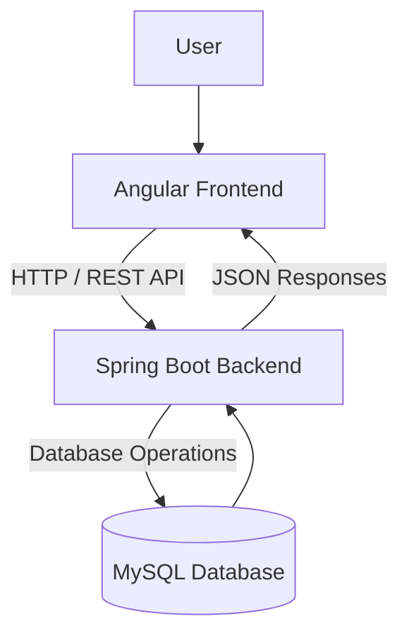

# Task Management Application

A full-stack task management web application built with **Angular**, **Java Spring Boot**, and **MySQL**. The project demonstrates how a component-based frontend communicates with a RESTful backend to create, retrieve, update, and delete tasks.

## Overview

This application provides a straightforward way to manage tasks through a web interface. It was developed to practice full-stack development, REST API integration, and relational database operations.

## Key Features

- **Create tasks** through the Angular frontend.
- **View tasks** retrieved from the Spring Boot backend.
- **Update existing tasks**.
- **Delete tasks** that are no longer needed.
- **Persist task records** in MySQL.
- **Connect frontend and backend** using HTTP requests to RESTful APIs.

## Technology Stack

| Layer | Technologies |
| --- | --- |
| Frontend | Angular, TypeScript, HTML, CSS, Bootstrap |
| Backend | Java, Spring Boot, RESTful APIs |
| Database | MySQL |
| Development tools | Git, GitHub |

## Architecture



The Angular application handles the user interface and communicates with the Spring Boot application. The backend processes requests and interacts with MySQL to store and retrieve task information.

## Repository Structure

```text
TO_DO_WEBAPP/
├── todo-frontend/     # Angular frontend
└── todo/              # Spring Boot backend
```


## Getting Started

### Prerequisites

Install the following tools:

- Node.js and npm
- Angular CLI (compatible with the Angular version in this project)
- Java JDK (compatible with the Spring Boot project)
- MySQL Server
- A Java build tool supported by the backend project (Maven or Gradle; check the files in `todo/`)

### 1. Clone the repository

```bash
git clone https://github.com/IT22595744/TO_DO_WEBAPP.git
cd TO_DO_WEBAPP
```

### 2. Configure the backend

1. Open the `todo/` folder in your preferred Java IDE.
2. Create a local MySQL database for the application.
3. Update the backend's database configuration (typically `src/main/resources/application.properties` or `application.yml`) with your local database URL, username, and password.
4. Install backend dependencies and run the Spring Boot application using the build configuration included in the project.


### 3. Start the Angular frontend

```bash
cd todo-frontend
npm install
npm start
```

If `npm start` is not defined in `package.json`, use the project's Angular CLI serve command instead:

```bash
ng serve
```

Open the local URL displayed in the terminal.

### 4. Connect the frontend to the API

Check the Angular API configuration and ensure it points to the URL and port where the Spring Boot backend is running. If frontend and backend run on different origins, verify the backend CORS configuration.

## API Functionality

The application uses REST APIs for core task operations:

| Operation | Purpose |
| --- | --- |
| Create | Add a new task |
| Read | Retrieve task information |
| Update | Modify an existing task |
| Delete | Remove a task |


## Screenshots

- **Task list:** Show the main interface with tasks displayed.
- **Create task:** Show the task creation form.
- **Edit task:** Show the task editing interface.

<!-- Example once an image exists:

-->

## Engineering Skills Demonstrated

- Developing frontend interfaces with Angular and TypeScript
- Implementing CRUD operations using Java and Spring Boot
- Integrating frontend components with RESTful APIs
- Working with MySQL relational data storage
- Understanding client-server architecture
- Organizing and maintaining full-stack application code

## Potential Improvements

The following are ideas for future development

- Add user authentication and role-based access control
- Add task priority, deadlines, and status filtering
- Add automated frontend and backend tests
- Containerize the application with Docker
- Deploy the application to a cloud hosting platform

## Author

**Muhammad Arshad**  
Software Engineering Graduate — Sri Lanka Institute of Information Technology (SLIIT)

- [GitHub](https://github.com/IT22595744)
- [LinkedIn](https://www.linkedin.com/in/mohamed-hilmi-arshad)
- [Portfolio](https://arshad-portfolio-website-tgvm.vercel.app/)

---

*This repository is a demonstration of full-stack application development using Angular, Java Spring Boot, and MySQL.*
